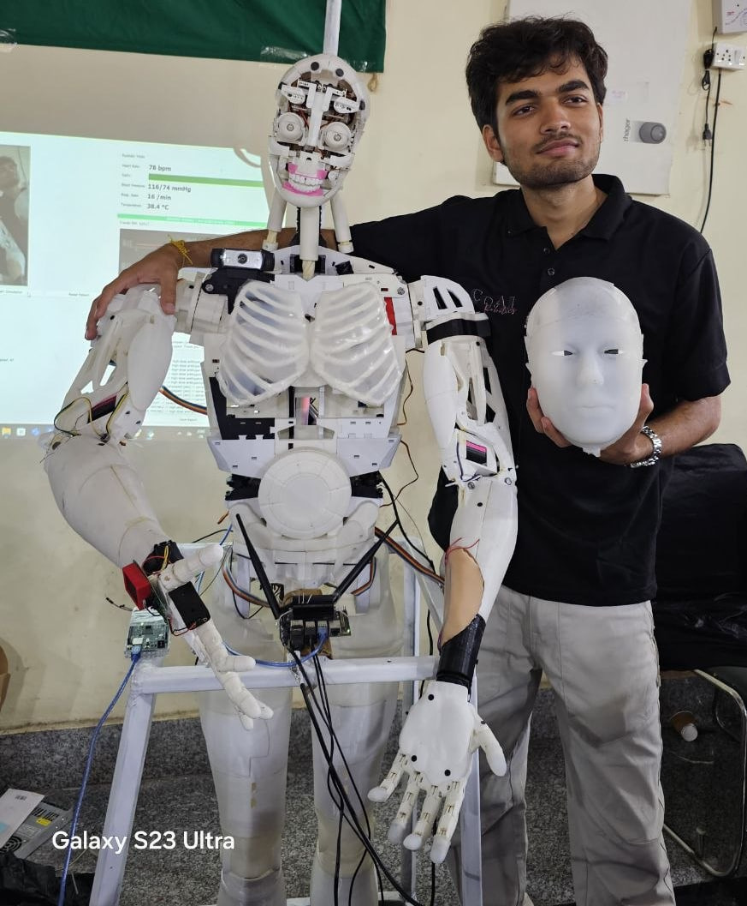

# ANANT — Dual-Mode AI Humanoid & Medical Training Simulator

> A full-scale (6 ft) 3D-printed humanoid that is both a **socially intelligent conversational companion** and a **touch-responsive standardized-patient simulator** for clinical training, built on a dual-compute architecture and open tooling.

<!-- Replace with your media -->

   
  <em>ANANT — 6 ft humanoid, silicone face, resistive touch skin.</em>

&nbsp; **Full media folder:** [Google Drive](https://drive.google.com/drive/folders/1SlCmQSr4eqgc99onE9jpQ5VC3Aau4ee3)

---

## Why ANANT

High-fidelity patient simulators that train clinicians on palpation, auscultation and rare presentations are imported systems costing roughly **₹3–4 crore/ $320,000–$427,000+-**, which puts them out of reach for most medical colleges. ANANT explores whether an open, 3D-printed, sensor-rich humanoid can deliver the *interaction* that matters in clinical teaching — a patient who looks at you, talks to you, reacts to where and how hard you press, and can be explained anatomically — at a fraction of that cost.

The same body doubles as a general-purpose **embodied-AI research platform**: face-aware conversation with long-term memory, expressive facial actuation, tactile sensing over a soft skin, and immersive XR teleoperation.

## Highlights

| Capability | Implementation |
|---|---|
| **Full-scale humanoid** | 6 ft, 3D-printed, 40+ high-torque servo actuators (head, face, neck, torso, both arms and hands) |
| **Tactile skin** | A prototype resistive silicone touch-sensor patch integrated into one hand; currently under testing |
| **Expressive face** | Silicone face actuated by 8+ servos; 7 expression presets (neutral, happy, sad, surprised, pain, angry, thinking) blended with timed transitions |
| **20+ sensors** | Touch zones, camera, microphone array, plus additional proprioceptive and environmental sensing |
| **Dual-compute stack** | **Jetson Nano** (perception, language, voice) + **Raspberry Pi 4B** (real-time servo/sensor control) |
| **Custom link protocol** | CRC-16 framed binary protocol, self-resynchronising parser, heartbeat watchdog and E-STOP |
| **Conversation** | Face recognition, per-person contextual memory (SQLite), real-time offline speech recognition, TTS with speech-synchronised jaw motion |
| **Medical mode** | Scenario-driven simulated patient: pressure-aware palpation, rebound tenderness, auscultation sites, vitals, rare-disease cases, timestamped session logs for assessment |
| **Anatomy projection** | Projector-mapped organ overlays on the torso for guided clinical examination |
| **XR teleoperation** | Meta Quest 3 hand tracking → closed-form arm IK, finger curl mapping, head-driven neck, deadman safety |

## Two modes

### Companion mode
ANANT recognizes returning people by face, greets them by name, recalls what they have told it ("my name is…", "I love robotics"), and answers in natural speech. Every LLM reply starts with an expression tag, which is parsed and sent to the face, so *what ANANT says and how it looks stay coherent*. Idle micro-behaviour (blinks, eye saccades) keeps it alive between turns. Touching the hand, cheek, forehead or shoulder triggers appropriate reactions.

### Medical training mode
Say *"medical mode"*, then *"load scenario appendicitis"*. The LLM role-plays the patient under strict rules (lay language, never reveals the diagnosis, answers only what is asked), while the skin drives physical examination:

- **Palpation**: touch a zone and ANANT reacts according to the scenario's tenderness map and how hard you press.
- **Rebound tenderness**: a deep press followed by a sudden release in the right zone triggers a stronger pain response, the way a real patient would.
- **Auscultation** (*"start auscultation"*): placing the stethoscope on a chest zone returns the finding for that site (text on trainer HUD, optional audio file).
- **Vitals** on request and **projected anatomy** on the torso for the relevant organs (*"show anatomy"*).
- **Session log**: every palpation, rebound, auscultation and question is timestamped and saved as JSON with the scenario's teaching points, ready for structured feedback.

Bundled scenarios (educational use only; they are training aids, not clinical guidance):

| Scenario | Teaching focus |
|---|---|
| `acute_appendicitis` | Pain migration, McBurney's point, rebound tenderness |
| `aortic_stenosis` | Exertional triad, ejection systolic murmur at the aortic area |
| `situs_inversus_totalis` | **Rare case**: dextrocardia, left-sided appendicitis, Kartagener association |

Adding a case is one JSON file in `config/scenarios/`.

## Research directions

ANANT is intended as a platform, not just a build. Natural next steps:

- **Soft and bio-inspired sensing/actuation**: richer multi-modal silicone skin (pressure localization, shear), compliant and tendon-driven facial and finger actuation, learned calibration of skin response.
- **Learning from demonstration**: the XR pipeline already records operator motion; logging synchronized teleoperation + tactile data enables imitation learning of gestures and manipulation primitives.
- **Humanoid control**: full 7-DoF arm IK with joint-limit and self-collision handling, whole-body posture control, and torque/impedance control for safe physical interaction.
- **Assistive and rehabilitation robotics**: tactile examination and guided physical interaction are shared problems with assistive devices; extending the platform toward lower-limb and gait-related simulation is a longer-term goal.
- **Clinical-education evaluation**: controlled studies of learning outcomes, objective scoring from session logs, and expansion of the rare-disease scenario library.

## Project status and limitations

Hardware-facing code (PCA9685, ADS1115, serial link, Vosk, camera) is written against the reference wiring in `docs/HARDWARE.md` and must be calibrated to each build. The simulation stack and unit tests run without hardware; the Quest client is a reference implementation to adapt to your Meta XR SDK version. ANANT is a **training aid**; scenarios are educational and not a substitute for clinical judgment or supervised teaching.

Total build cost: **₹ 1.8 lakhs** &nbsp;|&nbsp; Build time: **6-months** &nbsp;|&nbsp; Team: **Divyansh, Samriddhi, Gaytri**

## Acknowledgements

The mechanical base design of ANANT is built upon **[InMoov](https://inmoov.fr)**, the open-source 3D-printed humanoid created by **Gaël Langevin**. We are grateful to Gaël and the InMoov community for making this work possible. InMoov-derived parts remain under InMoov's license (CC BY-NC); see [NOTICE.md](NOTICE.md). ANANT's integration, skin, electronics, software and medical-simulation stack are original extensions.

## License

Software: MIT (see [LICENSE](LICENSE)). Mechanical designs derived from InMoov: CC BY-NC, as above.
